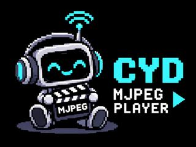
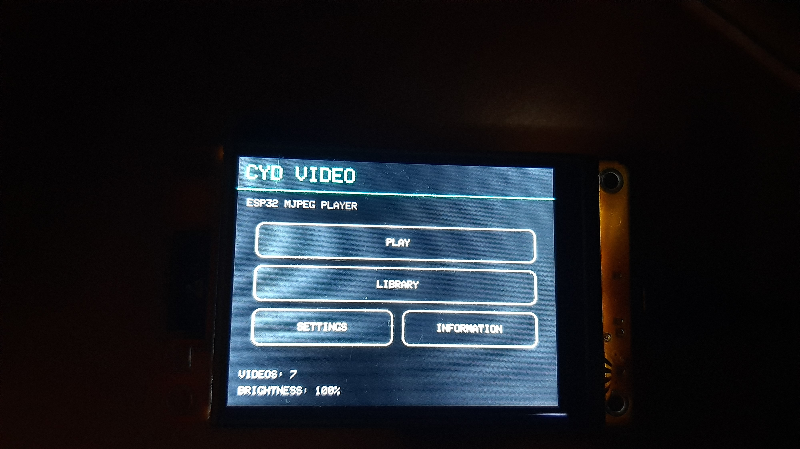
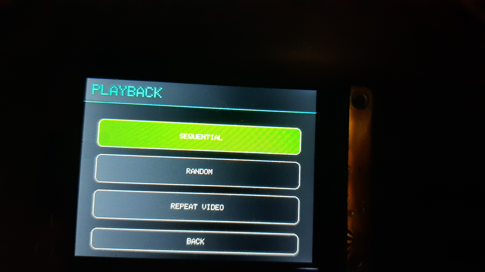
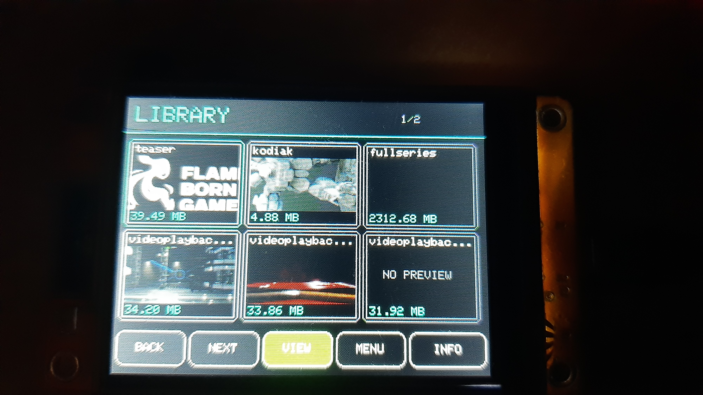
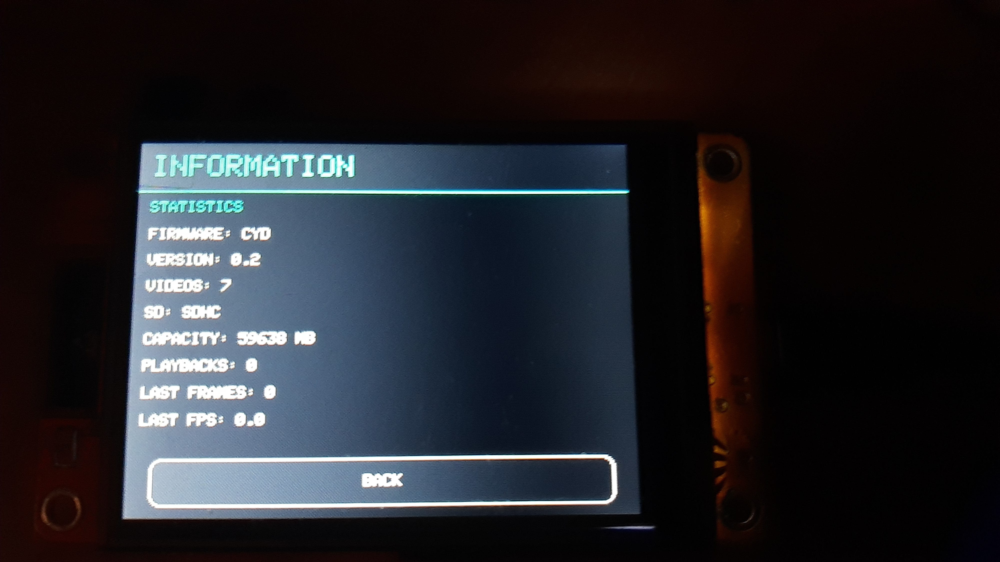
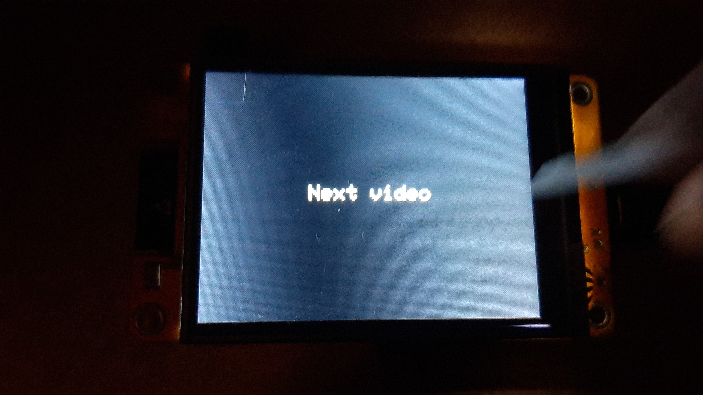
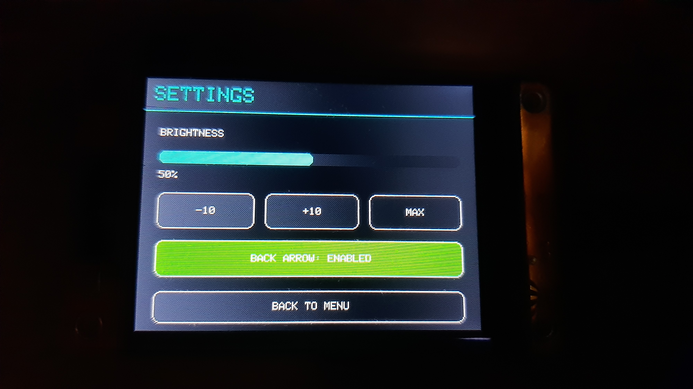

# CYD-MJPEG-Player
<p align="center">
  
</p>
An expanded and enhanced version of [The Last Outpost Workshop's ESP32-2432S028 video player](https://github.com/thelastoutpostworkshop/esp32-2432S028_video_player), adding a touch-controlled interface, video library, playback modes and more.

Created and modified by [DMPumuki](https://github.com/tancredyo1990-ship-it).

## Screenshots

Here are some screenshots showing the interface and features of CYD MJPEG Player.

### Main Menu



### Playback Options



### Video Library



### Video Information



### Video Navigation



### Settings



## Features

### Touch-Controlled Playback

- Swipe vertically along the screen to adjust brightness while a video is playing.
- Tap the right side of the screen to skip to the next video.
- Tap the left side of the screen to return to the previous video.
- An on-screen arrow (HUD) allows you to return to the main menu during playback.
- The playback navigation arrow can be enabled or disabled in the settings.

### Video Library

- Displays video previews in a six-item grid per page.
- Shows each video's filename and file size.
- Select a preview to play the video or access its information.

### Playback Modes

Three playback modes are available:

- **Sequential:** Plays videos in order, returning to the beginning after the last video.
- **Random:** Plays videos in a shuffled order.
- **Repeat:** Repeats the currently selected video.

### Settings

- Adjust screen brightness.
- Enable or disable the playback navigation arrow.

## Requirements and Important Notes

- An ESP32-2432S028 Cheap Yellow Display (CYD).
- A microSD card formatted as FAT32.
- Videos must be converted to MJPEG format before being copied to the card.
- Videos must use the `.mjpeg` file extension.
- Videos must be stored directly inside a folder named `mjpeg` in the root of the microSD card.
- The player does not support audio playback.
- A stylus is recommended for more comfortable and accurate touchscreen operation.

## Flashing the Firmware (Beginner's Guide)

Want to try the player? Getting it onto your CYD is quite simple. You don't need any special programming equipment or software.

### What do you need?

- An ESP32-2432S028 Cheap Yellow Display (CYD).
- A USB cable to connect it to your computer.
- A microSD card formatted as FAT32.

That's it!

### Step 1: Download the firmware

Go to the [Releases](https://github.com/tancredyo1990-ship-it/CYD-MJPEG-Player/releases) section of this repository.

Download the `.bin` firmware file attached to the latest release.

### Step 2: Open the web flasher

Visit [ESP Web Tool](https://esptool.spacehuhn.com/) using a compatible browser, such as Google Chrome or Microsoft Edge.

This website allows you to flash ESP32 firmware directly from your browser.

### Step 3: Connect your CYD

Connect your CYD to your computer using the USB cable.

On the ESP Web Tool website:

1. Select the option to connect to your device.
2. Choose the serial port corresponding to your CYD.
3. Allow the browser to access the serial port when prompted.

### Step 4: Flash the firmware

1. Select the option to choose a firmware file.
2. Load the `.bin` file you downloaded earlier.
3. Set the flash address to `0x0` if the tool asks for one.
4. Start the flashing process and wait for it to finish.

Once the process is complete, your CYD should be ready to run the player!

## Preparing the microSD Card

The microSD card must be formatted as **FAT32**.

Create a folder named `mjpeg` in the root directory of the card.

Copy your converted `.mjpeg` videos directly into this folder.

The folder structure should look like this:

```text
microSD/
└── mjpeg/
    ├── video1.mjpeg
    ├── video2.mjpeg
    └── video3.mjpeg
```

**Important:**

- The folder must be named exactly `mjpeg`.
- Video files must be placed directly inside this folder, not in subfolders.
- Only files with the `.mjpeg` extension are recognized.
- Empty video files are ignored.

The firmware is currently configured to register up to **2,000 video files** in the library. This is a configured limit, not a guarantee that every microSD card will perform equally well with that many files.

## Video Conversion

Videos must be converted to MJPEG format before they can be played.

You can use the original creator's [Video Conversion Studio](https://thelastoutpostworkshop.github.io/video_conversion/) to prepare your videos.

Remember that this player is designed for video playback without audio.

## Testing and Known Limitations

The player has been tested with several MJPEG files, including a video of approximately 2 GB.

Current testing includes a library of seven videos.

Some tests are still pending:

- Testing the library with a much larger number of videos, approaching the configured 2,000-file limit.
- Completing a full sequential playback cycle to verify that playback returns to the first video after reaching the end of the list.
- Further testing of random playback with a larger video library.

The project is still evolving, and these limits and behaviours may be refined in future versions.

## Suggestions and Feedback

Suggestions, ideas and feedback are welcome!

If you find a bug or have an idea for a new feature, feel free to open an issue in this repository.

## Credits

### Original Project

This project is based on the work of [The Last Outpost Workshop](https://github.com/thelastoutpostworkshop).

Original repository:
[ESP32-2432S028 Video Player](https://github.com/thelastoutpostworkshop/esp32-2432S028_video_player)

### Video Conversion Tool

[Video Conversion Studio](https://thelastoutpostworkshop.github.io/video_conversion/) by The Last Outpost Workshop.

### Modifications and Extensions

Modifications, new features, interface improvements and testing by [DMPumuki](https://github.com/tancredyo1990-ship-it).

## Development Acknowledgements

ChatGPT (OpenAI) was used as an AI assistance tool during development, helping with code implementation, debugging, problem-solving and exploring possible improvements.

Hardware testing, project direction, design decisions and final implementation were carried out by DMPumuki.

## License

This project is based on software originally released under the **MIT License** by The Last Outpost Workshop.

The original copyright notice and MIT License terms must be retained in accordance with the original license.

Please refer to the [original repository](https://github.com/thelastoutpostworkshop/esp32-2432S028_video_player) for the original project and license information.
